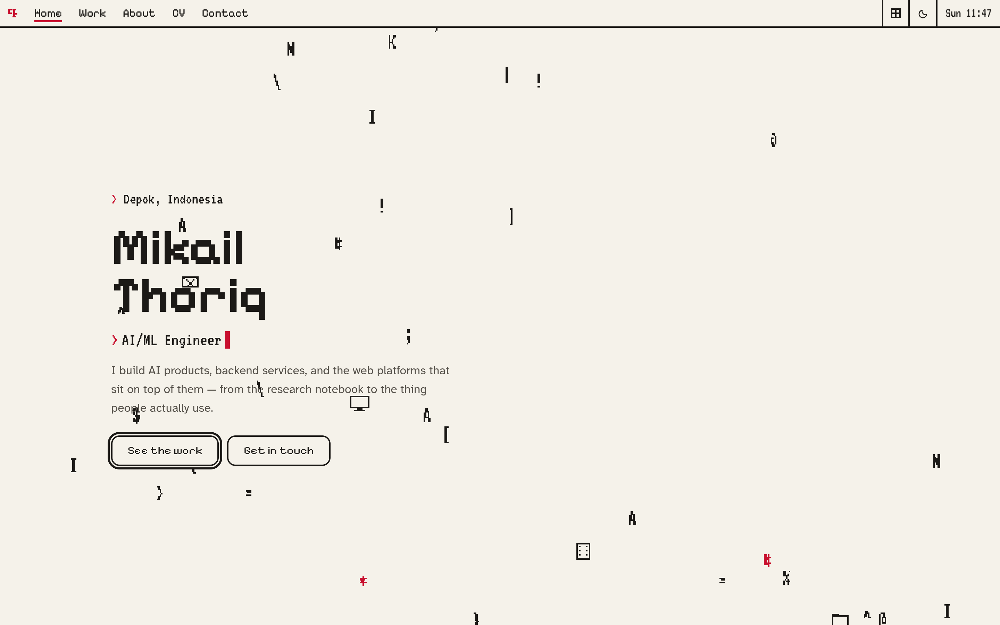
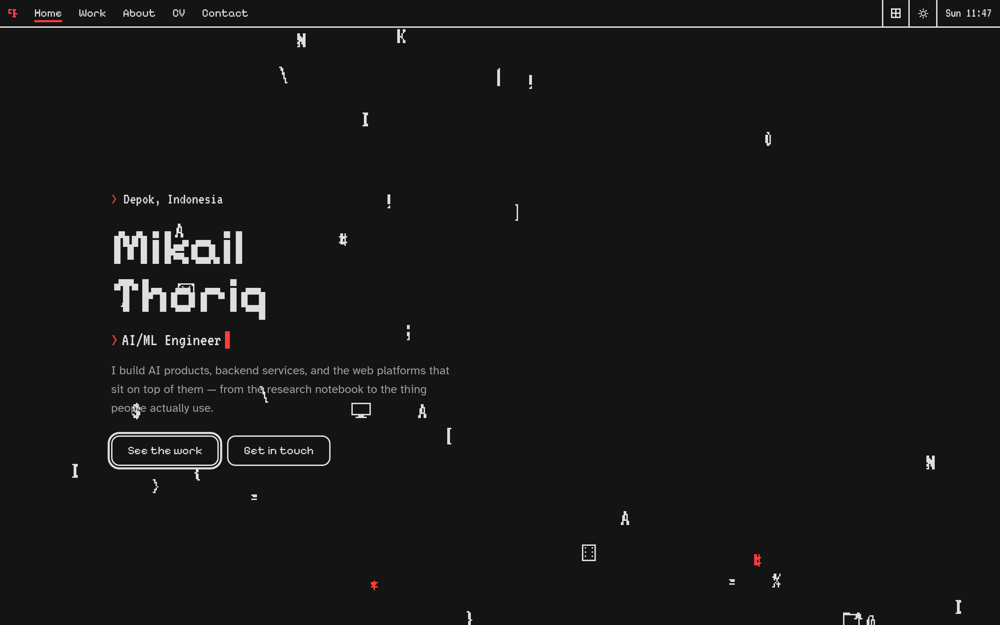
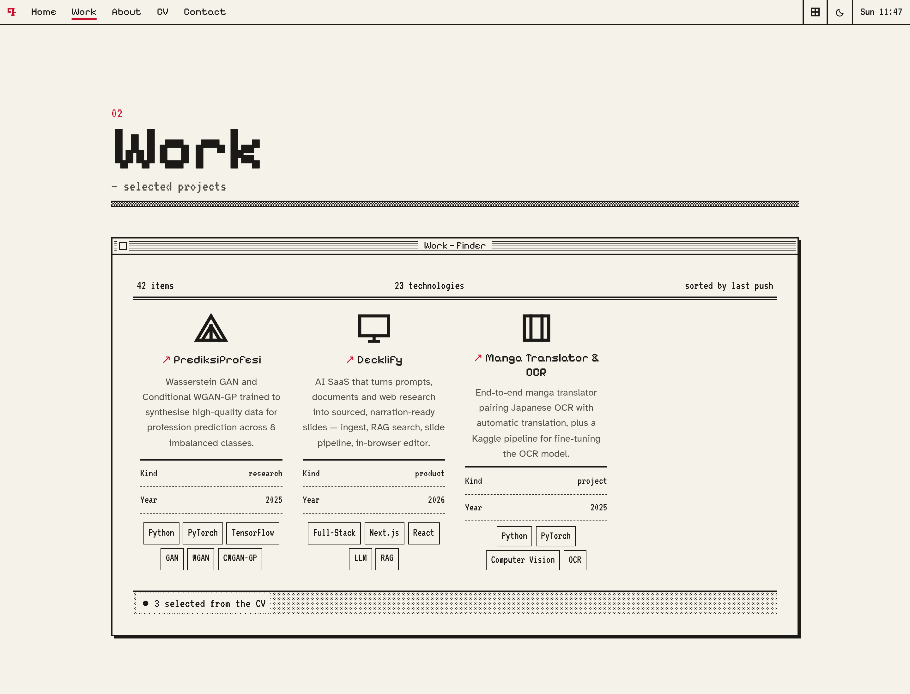
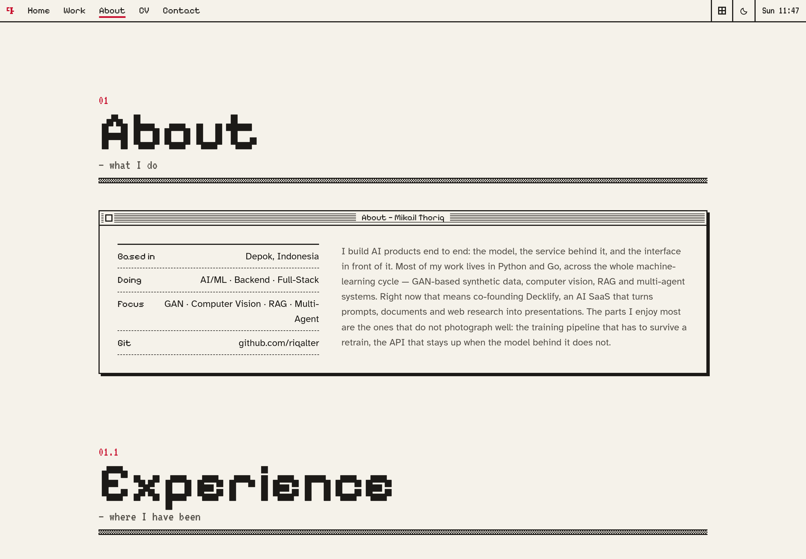
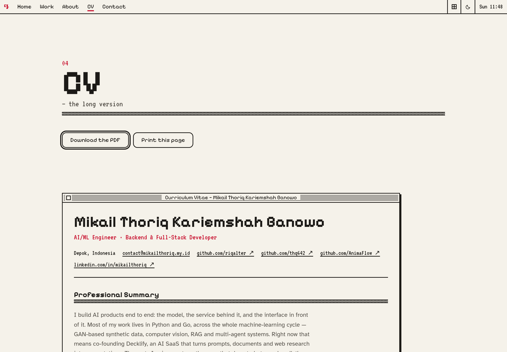
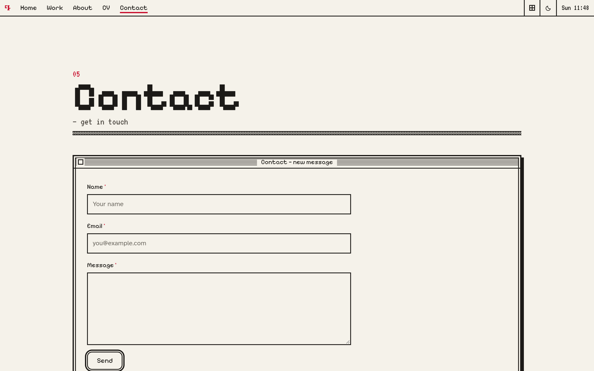

# Mikail Thoriq — personal site

A 1-bit personal site built with **Svelte 5** + **SvelteKit** (static output).

The visual language is System 1: two inks, one rationed red, halftone instead of
grey, and stepped motion everywhere. See `DESIGN_LANGUAGE.md`, `COLORSTYLE.md`
and `HOWITSWORK.md` in the repo root for the full specification this implements.

---

## Preview

<p align="center">
  
</p>

<table>
  <tr>
    <td width="50%"></td>
    <td width="50%"></td>
  </tr>
  <tr>
    <td></td>
    <td></td>
  </tr>
  <tr>
    <td></td>
    <td></td>
  </tr>
</table>

<p align="center"><sub>
Captured from the production build at 1440&nbsp;px, rendered at
<code>deviceScaleFactor: 2</code> — real 2× pixels, not an upscaled 1× grab.
Regenerate with <code>node scripts/screenshot.mjs</code> while
<code>npm run preview</code> is up.
</sub></p>

---

## Run it

```bash
npm install
npm run dev        # http://localhost:5173
npm run check      # svelte-check — types + a11y + unused CSS
npm run build      # static site → ./build
npm run preview    # serve ./build
```

---

## The six rules

1. **1-bit, one red.** Two inks and a single accent. Warm paper, warm near-black
   ink, and one crimson. There is no second accent hue.
2. **No grey.** Where a tone is needed, a halftone screen is drawn —
   `--pat-50` (50% checkerboard), `--pat-25` (25% dot screen), `--pat-rule`
   (1px line every 3px). Never `#888`.
3. **Red is rationed.** It marks *you are here*, *this is a control or state*, and
   *the brand*. Never decoration, never a heading, never a resting button fill.
4. **Everything steps.** There is not one `ease` in the stylesheet. A smooth
   transition breaks the illusion the moment it appears.
5. **Depth is drawn, never rendered.** `box-shadow: 4px 4px 0` — hard offset,
   zero blur. Buttons are the only thing allowed a radius (12px / 9px);
   inputs are square.
6. **Light and dark are the same design, not two.** Ink and paper swap
   *meaning*, so every existing inversion keeps working.

---

## Light / dark

Light is **warm paper**: cream stock, warm near-black ink, one crimson. Dark is
the same design on a dark surface. The toggle lives in the menu bar next to the
motion switch. It defaults to your OS preference, remembers your choice, and
follows the OS again only while you haven't expressed one. It resolves inline in
`app.html` before first paint, so there is no white flash on a dark-preferring
display.

### The palette

| | Light (warm) | Dark | |
|---|---|---|---|
| paper | `#f5f2ea` | `#141414` | pure `#000` smears on OLED scroll; pure `#fff` glares under long reading |
| ink | `#1c1a17` | `#dedede` | warm near-black; pure `#000` on cream reads harsh |
| red | `#c8102e` | `#ff3d3d` | **re-derived per surface, not carried over** |
| muted | `#55514a` | `#9e9e9e` | |
| placeholder | `#6e6a62` | `#8c8c8c` | |
| body contrast | 15.5:1 | 13.7:1 | above AAA (7:1), well short of the 21:1 that fatigues |

### Why the red had to be re-derived twice

The cold `#E00000` is tuned so its max channel is 224 rather than 255, precisely
so it clears 4.5:1 on white. That tuning is ground-specific:

| Red | ground | ratio | verdict |
|---|---|---|---|
| `#e00000` | `#ffffff` | 5.04:1 | the original's tuning |
| `#e00000` | `#141414` | **4.17:1** | **fails AA** |
| `#e00000` | `#f5f2ea` | **4.50:1** | passes with *zero* margin — any deeper stock breaks it |
| `#c8102e` | `#f5f2ea` | 5.26:1 | the warm ground's red |
| `#ff3d3d` | `#141414` | 5.25:1 | the dark ground's red |

A naive "invert the tokens" dark mode would have shipped a red that fails WCAG,
and a naive "just swap the paper" warm mode would have left it one shade away
from failing. Both are silent failures — nothing renders wrong, it just becomes
unreadable for the people who need it most.

### Two other traps this design sets

- **The halftones vanish.** `--pat-50` / `--pat-25` are data URIs, so they can't
  read a variable; each theme carries its own screens with that theme's ink.
  A pure-black screen on cream stock also just looks like a printing error.
- **Canvas and WebGL can't read CSS variables.** Both the swirl and the dither
  pipeline re-read the theme's inks on every switch — the swirl re-bakes its
  whole sprite sheet, and the dither shader thresholds into `uInk`/`uPaper`
  uniforms rather than emitting `#000`/`#fff`, so a 1-bit print is made of the
  surface it sits on instead of dropping a white rectangle onto a dark page.

---

## Where the content lives

**Every string on the site is in `src/lib/content.ts`.** Nothing is hardcoded in
components. Open that one file to change the copy.

Entries marked `TODO(CV)` are placeholders awaiting your CV text:

| Marker | What it needs |
|---|---|
| `identity.roles` | the roles you want typed in the hero |
| `identity.email` | your email — the contact form builds a `mailto:` from it |
| `copy.about` | your About paragraph in your own voice |
| `projects` | your projects — currently seeded from the two GitHub accounts |
| `experience` | your work history |
| `stack` | your tools, grouped |

Search the repo for `TODO(CV)` to find every one:

```bash
grep -rn 'TODO(CV)' src/
```

---

## File map

```
src/
├── app.html                  pre-paint motion + theme scripts (inline, must stay first)
├── app.css                   the design system: tokens, chrome, layout recipes
│   └── lib/
│       ├── content.ts            ← all site copy + the CV, transcribed
│       ├── icons.ts              1-bit SVG icon set (black only — the hover filter depends on it)
│       ├── motion.svelte.ts      the single motion switch + rAF latch
│       ├── theme.svelte.ts       the single theme switch + OS-following
│       ├── actions/zoom.ts       the System 1 zoom-rectangle window entrance
│       ├── gl/dither.ts          the Bayer 8×8 ordered-dither WebGL pipeline
│       ├── server/
│       │   ├── github.ts         fetches the three accounts at BUILD time
│       │   └── github-cache.ts   6-hour disk cache + stale fallback
│       └── components/
│           ├── MenuBar.svelte    sticky chrome, clock, pull-down, motion + theme toggles
│           ├── Window.svelte     the window form (+ --dialog variant)
│           ├── SectionHead.svelte
│           ├── Hero.svelte
│           ├── Swirl.svelte      the 1-bit glyph field
│           ├── Typewriter.svelte
│           ├── FileCard.svelte   Finder icon view
│           ├── AccountCard.svelte  GitHub profile card
│           ├── DitherMedia.svelte  dithered image with Bayer-order reveal
│           └── Desktop.svelte    the footer, which doubles as site navigation
└── routes/
    ├── +layout.svelte
    ├── +page.svelte             home
    ├── work/+page.server.ts     ← the only route that hits the network
    ├── work/+page.svelte
    ├── about/+page.svelte
    ├── cv/+page.svelte          the CV as a document + print stylesheet
    └── contact/+page.svelte
api/
└── contact.ts              Vercel function → MailerSend (holds the API token)
```

---

---

## Where the content comes from

| What | Source |
|---|---|
| Identity, roles, experience, skills, education, certifications, awards, languages | `Mikail_Thoriq_Banowo_CV_ID_V1-1.pdf`, transcribed into `content.ts` and translated to English |
| The three hand-written project cards | The CV's *PROYEK PILIHAN* (`featured` in `content.ts`) |
| Everything in the "Repositories" window | The GitHub API, at build time |
| The PDF download button | `/static/cv/mikail-thoriq-banowo-cv.pdf`, a copy of the original |

`content.ts` is the single source of truth for prose. `experience` is derived from
`roles` so the About page and the CV page can never disagree.

### The GitHub fetch

`riqalter` and `thq642` (users) and `AnimaFlow` (org) are listed in `accounts` in
`content.ts`. `work/+page.server.ts` calls the API once during `vite build` and
the result is baked into the static HTML — the visitor never talks to GitHub,
and there is no client-side rate-limit exposure.

**Add an API token (recommended).** Unauthenticated, GitHub allows 60 requests
per hour per IP and a build spends six of them. A token raises that to 5000:

```bash
cp .env.example .env      # then paste the token into GITHUB_TOKEN=
```

A fine-grained token with read-only public access is enough — this build never
writes to GitHub. `.env` is gitignored. With a token the cache window drops from
6 hours to 30 minutes, so every build sees fresh data.

**The cache exists so a build never ships an empty page.** Results are written to
`.github-cache.json` at the repo root. If the network fails or you are
rate-limited, the last good copy is served and the window says so. Delete the
file to force a refresh.

Adding a fourth account is one line in `accounts`; nothing else needs touching.

---

## Notes for whoever edits this next

- **Motion is resolved in an inline `<head>` script before first paint.** Do not
  move it into a module. If JS never runs, `<html>` never gets `.js`, and every
  window stays visible instead of being hidden at `opacity: 0`.
- **The dither pipeline gamma-corrects before thresholding** (`sqrt(luma)`).
  Without it, dark artwork dithers into noise.
- **The dither reveal is Bayer-ordered in 2×2-cell blocks**, not a cross-fade.
  That difference is the whole point of the effect.
- **DPR is capped at 1.5** in the renderer. Past that the extra fragments buy
  nothing on a 1-bit image.
- **Icons must stay pure black/white/red.** The hover recolour is a single CSS
  filter (`invert(1) hue-rotate(180deg)`); an orange icon would break it silently.
- **The contact form posts to `/api/contact`**, a Vercel serverless function that
  forwards to MailerSend. The API token is a Vercel environment variable and
  never reaches the browser — a client-side fetch would publish it in the
  bundle. If the function is unreachable (e.g. plain `vite dev`), the form falls
  back to `mailto:` automatically.
- **The honeypot field must stay reachable to bots.** It is positioned
  off-screen, not `display: none` — a bot filtering on visibility would skip it.

## Deploying

`npm run build` writes a fully static site to `./build`. `vercel.json` tells
Vercel to serve that directory *and* deploy `api/contact.ts` as a serverless
function, so the site and the contact endpoint ship together.

### Contact form setup (Vercel + MailerSend)

The function needs these environment variables — Vercel dashboard → Project →
Settings → Environment Variables. Set them for **all** environments:

| Variable | Required | Notes |
|---|---|---|
| `MAILERSEND_API_TOKEN` | yes | MailerSend → Settings → API tokens |
| `MAILERSEND_TO` | yes | where messages should land |
| `MAILERSEND_FROM` | yes¹ | must be a verified sender in MailerSend |
| `MAILERSEND_FROM_NAME` | no | display name, defaults to the site name |
| `ALLOWED_ORIGIN` | no | defaults to the deploy's own host |

¹ falls back to `MAILERSEND_TO` if unset, which is the right default for a
Gmail sender account before you verify a domain.

`vercel dev` runs the function locally; plain `npm run dev` does not, so the
form falls back to `mailto:` there. To test the real path, run `vercel dev`.

**On any other static host** (Netlify, Cloudflare Pages, GitHub Pages) the
static site still builds and deploys unchanged — only the form degrades to
`mailto:`, because those hosts need their own function format.

### Other hosts

Drop `build/` on any static host. `trailingSlash` is set to `always`, so enable
"clean URLs"/directory-style routing if your host needs it.

For GitHub Pages project sites, set `base` in `svelte.config.js`:

```js
kit: { paths: { base: '/your-repo' } }
```